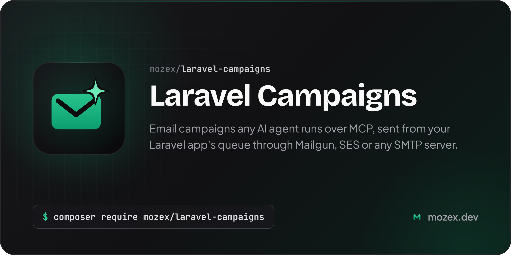

[](https://mozex.dev/docs/laravel-campaigns)

# Laravel Campaigns

[](https://packagist.org/packages/mozex/laravel-campaigns)
[](https://github.com/mozex/laravel-campaigns/actions/workflows/checks.yml)
[](https://mozex.dev/docs/laravel-campaigns/v1)
[](https://packagist.org/packages/mozex/laravel-campaigns)
[](https://packagist.org/packages/mozex/laravel-campaigns)

Laravel Campaigns runs your email marketing inside your own Laravel app, and AI agents operate it. The app keeps the lists, in step with your own users, records every subscribe and unsubscribe with its source and basis, and sends each campaign from its own queue, one email at a time, at the pace you set. Emails leave through a driver: Mailgun, Amazon SES and any SMTP server are built in, and another service needs a class of your own. The agents can be any AI app that speaks MCP (Claude Code, Claude's desktop app, ChatGPT, Cursor, Codex): they connect to the MCP server the package adds to your app, then draft, preview, test, start and watch campaigns without database access. Addresses that hard-bounce, report spam or unsubscribe stop getting mail on their own.

> **[Read the full documentation at mozex.dev](https://mozex.dev/docs/laravel-campaigns/v1)**: searchable docs, version requirements, detailed changelog, and more.

## Table of Contents

- [Introduction](https://github.com/mozex/laravel-campaigns/blob/main/docs/introduction.md)
- Getting Started
  - [Installation](https://github.com/mozex/laravel-campaigns/blob/main/docs/getting-started/installation.md)
  - [Mailgun](https://github.com/mozex/laravel-campaigns/blob/main/docs/getting-started/mailgun.md)
  - [SMTP](https://github.com/mozex/laravel-campaigns/blob/main/docs/getting-started/smtp.md)
  - [Amazon SES](https://github.com/mozex/laravel-campaigns/blob/main/docs/getting-started/ses.md)
  - [Connecting Agents](https://github.com/mozex/laravel-campaigns/blob/main/docs/getting-started/connecting-agents.md)
  - [Optional Extras](https://github.com/mozex/laravel-campaigns/blob/main/docs/getting-started/optional-extras.md)
- Lists and Subscribers
  - [Dynamic Lists](https://github.com/mozex/laravel-campaigns/blob/main/docs/lists-and-subscribers/dynamic-lists.md)
  - [Subscriptions and Consent](https://github.com/mozex/laravel-campaigns/blob/main/docs/lists-and-subscribers/subscriptions.md)
  - [Imports](https://github.com/mozex/laravel-campaigns/blob/main/docs/lists-and-subscribers/imports.md)
  - [Engagement and the Sunset](https://github.com/mozex/laravel-campaigns/blob/main/docs/lists-and-subscribers/engagement.md)
- Campaigns
  - [Emails and Templates](https://github.com/mozex/laravel-campaigns/blob/main/docs/campaigns/emails.md)
  - [Audiences](https://github.com/mozex/laravel-campaigns/blob/main/docs/campaigns/audiences.md)
  - [Sending and Pace](https://github.com/mozex/laravel-campaigns/blob/main/docs/campaigns/sending.md)
  - [Feedback and the Stop-Loss](https://github.com/mozex/laravel-campaigns/blob/main/docs/campaigns/feedback.md)
  - [Opens and Clicks](https://github.com/mozex/laravel-campaigns/blob/main/docs/campaigns/tracking.md)
- Agents
  - [The MCP Server](https://github.com/mozex/laravel-campaigns/blob/main/docs/agents/mcp-server.md)
  - [Giving Agents Your Data](https://github.com/mozex/laravel-campaigns/blob/main/docs/agents/your-data.md)
- Reference
  - [Configuration](https://github.com/mozex/laravel-campaigns/blob/main/docs/reference/configuration.md)
  - [Commands](https://github.com/mozex/laravel-campaigns/blob/main/docs/reference/commands.md)
  - [Events](https://github.com/mozex/laravel-campaigns/blob/main/docs/reference/events.md)
  - [Testing Your App](https://github.com/mozex/laravel-campaigns/blob/main/docs/reference/testing.md)
  - [Drivers](https://github.com/mozex/laravel-campaigns/blob/main/docs/reference/drivers.md)
  - [Privacy and Security](https://github.com/mozex/laravel-campaigns/blob/main/docs/reference/privacy-and-security.md)

## Support This Project

I maintain this package along with [several other open-source PHP packages](https://mozex.dev/docs) used by thousands of developers every day.

If my packages save you time or help your business, consider [**sponsoring my work on GitHub Sponsors**](https://github.com/sponsors/mozex). Your support lets me keep these packages updated, respond to issues quickly, and ship new features.

Business sponsors get logo placement in package READMEs. [**See sponsorship tiers →**](https://github.com/sponsors/mozex)

## What You Get

**Agents do the work, you approve it.** An MCP server with 48 tools lets an agent write, upload, preview and test an email, count its audience, and start, pace, pause and report on a campaign. Read-only and full tokens, or your own OAuth sign-in with the rights one method on your user model gives, decide who can do what, and the risky calls (starting, resuming or speeding up a campaign, a test email, archiving a list or template, unblocking an address, running an import) ask the person first in Claude Code.

**Lists that are your users.** A dynamic list follows one of your models, so sign-ups, address changes, bans and deletions reach it as they happen. Static lists hold everyone else: newsletter sign-ups, imports from another service. Mark the lists your newsletters usually reach as default lists, and a campaign that names no lists goes to them, while a list made for one occasion gets only the campaigns that name it. Each list shows who joined it in the last 30 days and from where, and which campaign last used it.

**Consent you can prove.** Every subscribe, opt-out, block and confirmation is an append-only record with its source and basis. One unsubscribe stops all your marketing to that person, and only the person can undo it.

**Sending that warms up.** Each campaign starts small (100 emails on day one by default), grows each day, and goes out a few emails a minute from your own queue, engaged readers first, mailbox providers in turn.

**Feedback that acts.** Each driver reads back what its service reports, Mailgun through its webhooks and logs, Amazon SES through its events on EventBridge: a hard bounce or spam report blocks the address, an unsubscribe opts the person out. An SMTP server tells the sender only what it refuses on the spot, and the server says so to every agent. A stop-loss pauses a campaign, or a whole sending domain, past its bounce, complaint or unsubscribe limits, and emails you.

**The same checks in every client.** The server reads how much of your provider's plan or quota the account has used, and, with a Google service account key, the sending domain's Gmail spam rate from Postmaster Tools. An agent sees both before it asks you to start a campaign, and again in the answer to every start, resume and speed-up, whichever AI app it runs in.

**Opens and clicks on every driver.** Your app serves each email's open pixel and the redirects behind its links, so tracking works the same whichever service sends. Apple's privacy prefetch, link scanners and anything that opens an email the second it arrives count as machines, never as a person reading. The report counts the people who clicked each link, so a link Gmail fetches again after a click still counts as one person.

**The pages every email needs.** One-click unsubscribe for mail apps, an unsubscribe page, double opt-in confirmation and a web version, each link holding a token that's stored only as a hash.

**Your coding agent knows it too.** The package ships a [Laravel Boost](https://laravel.com/docs/boost) guideline and skill, so the agent that writes your app's code knows the rules for wiring in lists, sign-up forms, imports and audiences.

## Installation

> **Requires [PHP 8.2+](https://php.net/releases/)** - see [all version requirements](https://mozex.dev/docs/laravel-campaigns/v1/requirements)

```bash
composer require mozex/laravel-campaigns
```

Then run the install command. It publishes the config file and the migrations, which you run with `php artisan migrate`. Run it again after updating to a version that adds a migration: it publishes only the new ones.

```bash
php artisan campaigns:install
```

## Quick Start

Send from a domain kept for marketing, such as `news.example.com`, set up at your provider with SPF, DKIM and a DMARC record. The package sends through a mailer named `campaigns` in `config/mail.php`. With Mailgun, the default driver:

```php
'campaigns' => [
    'transport' => 'mailgun',
    'scheme' => 'api',
    'domain' => env('CAMPAIGNS_MAILGUN_DOMAIN'),
    'secret' => env('CAMPAIGNS_MAILGUN_SECRET'),
    'endpoint' => env('CAMPAIGNS_MAILGUN_ENDPOINT', 'api.mailgun.net'),
],
```

Point the domain's webhooks in Mailgun at `https://your-app.example.com/campaigns/webhooks/mailgun`, so bounces, spam reports and unsubscribes come back, and set the sender:

```dotenv
MAILGUN_WEBHOOK_SIGNING_KEY=your-webhook-signing-key
CAMPAIGNS_FROM_ADDRESS=hello@news.example.com
CAMPAIGNS_FROM_NAME="Example"
CAMPAIGNS_POSTAL_ADDRESS="Example Ltd, 1 Main Street, Springfield"
CAMPAIGNS_PRIVACY_URL=https://example.com/privacy
CAMPAIGNS_TEST_ADDRESSES=you@example.com
```

Amazon SES and SMTP servers take a different mailer and bring feedback back their own way: see [Amazon SES](https://github.com/mozex/laravel-campaigns/blob/main/docs/getting-started/ses.md) and [SMTP](https://github.com/mozex/laravel-campaigns/blob/main/docs/getting-started/smtp.md).

Turn one of your models into a list. The source says who belongs on it and what to keep in step:

```php
namespace App\Campaigns;

use App\Models\User;
use Illuminate\Database\Eloquent\Builder;
use Illuminate\Database\Eloquent\Model;
use Mozex\Campaigns\Contracts\ListSource;

class AccountList implements ListSource
{
    public function name(): string
    {
        return 'Accounts';
    }

    public function query(): Builder
    {
        return User::query();
    }

    public function isEligible(Model $record): bool
    {
        return $record->banned_at === null;
    }

    public function fields(Model $record): array
    {
        return ['email' => $record->email, 'name' => $record->name];
    }
}
```

```php
// config/campaigns.php
'list_sources' => ['accounts' => App\Campaigns\AccountList::class],
```

Add `use Mozex\Campaigns\Concerns\HasCampaignSubscriber;` to the `User` model, then bring in the accounts you already have (a dry run first, then with `--force`) and make a token for your agent:

```bash
php artisan campaigns:sync-list accounts
php artisan campaigns:sync-list accounts --force
php artisan campaigns:token create laptop
claude mcp add --transport http campaigns https://your-app.example.com/mcp/campaigns \
  --header "Authorization: Bearer <token>"
```

Other MCP clients take the same address and header. Run `php artisan storage:link` (email images go on the `public` disk by default, so `APP_URL` must be https), a worker for the `campaigns` queue and the scheduler, then set `CAMPAIGNS_ENABLED=true` and ask your agent to send you a test.

The [installation guide](https://github.com/mozex/laravel-campaigns/blob/main/docs/getting-started/installation.md) walks through every required step in order, for any provider, host and CDN, and [Optional Extras](https://github.com/mozex/laravel-campaigns/blob/main/docs/getting-started/optional-extras.md) covers what you can add after: Gmail's spam rate, your plan's volume, OAuth sign-in for chat apps and the rest.

## Resources

Visit the [documentation site](https://mozex.dev/docs/laravel-campaigns/v1) for searchable docs auto-updated from this repository.

- **[AI Integration](https://mozex.dev/docs/laravel-campaigns/v1/ai-integration)**: Use this package with AI coding assistants via Context7 and Laravel Boost
- **[Requirements](https://mozex.dev/docs/laravel-campaigns/v1/requirements)**: PHP, Laravel, and dependency versions
- **[Changelog](https://mozex.dev/docs/laravel-campaigns/v1/changelog)**: Release history with linked pull requests and diffs
- **[Contributing](https://mozex.dev/docs/laravel-campaigns/v1/contributing)**: Development setup, code quality, and PR guidelines
- **[Questions & Issues](https://mozex.dev/docs/laravel-campaigns/v1/questions-and-issues)**: Bug reports, feature requests, and help
- **[Security](mailto:hello@mozex.dev)**: Report vulnerabilities directly via email

## License

The MIT License (MIT). Please see [License File](LICENSE.md) for more information.
