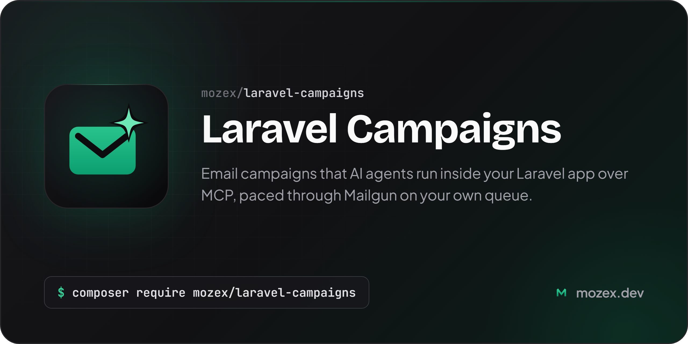

[](https://mozex.dev/docs/laravel-campaigns)

# Laravel Campaigns

[](https://packagist.org/packages/mozex/laravel-campaigns)
[](https://github.com/mozex/laravel-campaigns/actions/workflows/checks.yml)
[](https://mozex.dev/docs/laravel-campaigns/v1)
[](https://packagist.org/packages/mozex/laravel-campaigns)
[](https://packagist.org/packages/mozex/laravel-campaigns)

Laravel Campaigns lets an AI agent run your app's email marketing from inside the app. Your lists stay in step with your own users, every subscribe and unsubscribe is recorded with its basis and source, and campaigns go out through Mailgun, any SMTP server, or a driver you write for another service, from your own queue, one message at a time, at a pace you set per campaign. Addresses that hard-bounce, report spam or unsubscribe stop getting mail on their own. Agents work through an MCP server the package adds to your app, so Claude Code, Codex or a chat app can draft, preview, test, start and watch a campaign without database access.

> **[Read the full documentation at mozex.dev](https://mozex.dev/docs/laravel-campaigns/v1)**: searchable docs, version requirements, detailed changelog, and more.

## Table of Contents

- [Introduction](https://mozex.dev/docs/laravel-campaigns/v1)
- Getting Started
  - [Installation](https://mozex.dev/docs/laravel-campaigns/v1/getting-started/installation)
  - [Mailgun](https://mozex.dev/docs/laravel-campaigns/v1/getting-started/mailgun)
  - [SMTP](https://mozex.dev/docs/laravel-campaigns/v1/getting-started/smtp)
  - [Connecting Agents](https://mozex.dev/docs/laravel-campaigns/v1/getting-started/connecting-agents)
- Lists and Subscribers
  - [Dynamic Lists](https://mozex.dev/docs/laravel-campaigns/v1/lists-and-subscribers/dynamic-lists)
  - [Subscriptions and Consent](https://mozex.dev/docs/laravel-campaigns/v1/lists-and-subscribers/subscriptions)
  - [Imports](https://mozex.dev/docs/laravel-campaigns/v1/lists-and-subscribers/imports)
  - [Engagement and the Sunset](https://mozex.dev/docs/laravel-campaigns/v1/lists-and-subscribers/engagement)
- Campaigns
  - [Emails and Templates](https://mozex.dev/docs/laravel-campaigns/v1/campaigns/emails)
  - [Audiences](https://mozex.dev/docs/laravel-campaigns/v1/campaigns/audiences)
  - [Sending and Pace](https://mozex.dev/docs/laravel-campaigns/v1/campaigns/sending)
  - [Feedback and the Stop-Loss](https://mozex.dev/docs/laravel-campaigns/v1/campaigns/feedback)
- Agents
  - [The MCP Server](https://mozex.dev/docs/laravel-campaigns/v1/agents/mcp-server)
  - [Giving Agents Your Data](https://mozex.dev/docs/laravel-campaigns/v1/agents/your-data)
- Reference
  - [Configuration](https://mozex.dev/docs/laravel-campaigns/v1/reference/configuration)
  - [Commands](https://mozex.dev/docs/laravel-campaigns/v1/reference/commands)
  - [Events](https://mozex.dev/docs/laravel-campaigns/v1/reference/events)
  - [Testing Your App](https://mozex.dev/docs/laravel-campaigns/v1/reference/testing)
  - [Drivers](https://mozex.dev/docs/laravel-campaigns/v1/reference/drivers)
  - [Privacy and Security](https://mozex.dev/docs/laravel-campaigns/v1/reference/privacy-and-security)

## Support This Project

I maintain this package along with [several other open-source PHP packages](https://mozex.dev/docs) used by thousands of developers every day.

If my packages save you time or help your business, consider [**sponsoring my work on GitHub Sponsors**](https://github.com/sponsors/mozex). Your support lets me keep these packages updated, respond to issues quickly, and ship new features.

Business sponsors get logo placement in package READMEs. [**See sponsorship tiers →**](https://github.com/sponsors/mozex)

## What You Get

**Agents do the work, you approve it.** An MCP server with 48 tools lets an agent write, upload, preview and test an email, count its audience, and start, pace, pause and report on a campaign. Read-only and full tokens, or your own OAuth sign-in, decide who can do what, and the risky calls (starting, resuming or speeding up a campaign, a test email, archiving a list or template, unblocking an address, running an import) ask the person first in Claude Code.

**Lists that are your users.** A dynamic list follows one of your models, so sign-ups, address changes, bans and deletions reach it as they happen. Static lists hold everyone else: newsletter sign-ups, imports from another service.

**Consent you can prove.** Every subscribe, opt-out, block and confirmation is an append-only record with its source and basis. One unsubscribe stops all your marketing to that person, and only the person can undo it.

**Sending that warms up.** Each campaign starts small (100 emails on day one by default), grows each day, and goes out a few emails a minute from your own queue, engaged readers first, mailbox providers in turn.

**Feedback that acts.** Mailgun's webhooks and logs block hard bounces and spam reports and opt out unsubscribes. The SMTP driver sends through any server and reads back only what it refuses on the spot, and another service plugs in as a driver that has to do no more than send. A stop-loss pauses a campaign, or a whole sending domain, past its bounce, complaint or unsubscribe limits, and emails you.

**The pages every email needs.** One-click unsubscribe for mail apps, an unsubscribe page, double opt-in confirmation and a web version, each link holding a token that's stored only as a hash.

## Installation

> **Requires [PHP 8.2+](https://php.net/releases/)** - see [all version requirements](https://mozex.dev/docs/laravel-campaigns/v1/requirements)

```bash
composer require mozex/laravel-campaigns
```

Then run the install command once. It publishes the config file and the migration, which you run with `php artisan migrate`.

```bash
php artisan campaigns:install
```

## Quick Start

Add a `campaigns` mailer on Mailgun's API to `config/mail.php`, on a domain kept for marketing:

```php
'campaigns' => [
    'transport' => 'mailgun',
    'scheme' => 'api',
    'domain' => env('CAMPAIGNS_MAILGUN_DOMAIN'),
    'secret' => env('CAMPAIGNS_MAILGUN_SECRET'),
],
```

Turn one of your models into a list. The source says who belongs on it and what to keep in step:

```php
namespace App\Campaigns;

use App\Models\User;
use Illuminate\Database\Eloquent\Builder;
use Illuminate\Database\Eloquent\Model;
use Mozex\Campaigns\Contracts\ListSource;

class AccountList implements ListSource
{
    public function name(): string
    {
        return 'Accounts';
    }

    public function query(): Builder
    {
        return User::query();
    }

    public function isEligible(Model $record): bool
    {
        return $record->banned_at === null;
    }

    public function fields(Model $record): array
    {
        return ['email' => $record->email, 'name' => $record->name];
    }
}
```

```php
// config/campaigns.php
'list_sources' => ['accounts' => App\Campaigns\AccountList::class],
```

Add `use Mozex\Campaigns\Concerns\HasCampaignSubscriber;` to the `User` model, then bring in the accounts you already have (a dry run first, then with `--force`) and make a token for your agent:

```bash
php artisan campaigns:sync-list accounts
php artisan campaigns:sync-list accounts --force
php artisan campaigns:token create laptop
claude mcp add --transport http campaigns https://your-app.example.com/mcp/campaigns \
  --header "Authorization: Bearer <token>"
```

Point Mailgun's webhooks at `/campaigns/webhooks/mailgun`, run a worker for the `campaigns` queue and the scheduler, and set `CAMPAIGNS_ENABLED=true` when you're ready to send. Then ask your agent to draft a campaign.

The [documentation](https://mozex.dev/docs/laravel-campaigns/v1) covers each piece: Mailgun's keys, OAuth for chat apps, consent on your sign-up form, named audiences, the pace and the stop-loss.

## Resources

Visit the [documentation site](https://mozex.dev/docs/laravel-campaigns/v1) for searchable docs auto-updated from this repository.

- **[AI Integration](https://mozex.dev/docs/laravel-campaigns/v1/ai-integration)**: Use this package with AI coding assistants via Context7 and Laravel Boost
- **[Requirements](https://mozex.dev/docs/laravel-campaigns/v1/requirements)**: PHP, Laravel, and dependency versions
- **[Changelog](https://mozex.dev/docs/laravel-campaigns/v1/changelog)**: Release history with linked pull requests and diffs
- **[Contributing](https://mozex.dev/docs/laravel-campaigns/v1/contributing)**: Development setup, code quality, and PR guidelines
- **[Questions & Issues](https://mozex.dev/docs/laravel-campaigns/v1/questions-and-issues)**: Bug reports, feature requests, and help
- **[Security](mailto:hello@mozex.dev)**: Report vulnerabilities directly via email

## License

The MIT License (MIT). Please see [License File](LICENSE.md) for more information.
